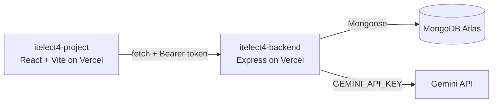

# itelect4-backend

[](https://github.com/yuki-dev14/itelect4-backend/actions/workflows/ci.yml)

The REST API behind the ITELECT4 class demo, end of Session 12: Express 5 in TypeScript, MongoDB Atlas through Mongoose, JWT login, and one route that asks Gemini to review a project description.

- **Live API:** https://itelect4-backend-euclids-projects-447a0a30.vercel.app/api/health
- **Frontend App:** https://itelect4-project-it4b.vercel.app
- **Frontend Repo:** https://github.com/yuki-dev14/itelect4-project-it4b

## Architecture



## Running Locally

1. Install dependencies:
   ```bash
   npm install
   ```
2. Configure `.env` based on `.env.example`:
   ```bash
   PORT=4000
   MONGODB_URI=<your-mongodb-atlas-uri>
   JWT_SECRET=<your-jwt-secret>
   GEMINI_API_KEY=<your-gemini-api-key>
   CORS_ORIGIN=http://localhost:5173
   ```
3. Run in development mode:
   ```bash
   npm run dev
   ```
4. Run tests:
   ```bash
   npm test
   ```
5. Run type checks:
   ```bash
   npm run typecheck
   ```

## AI Disclosure

This project utilizes Google's Gemini API (`gemini-flash-latest` via `@google/genai`) to provide structured AI project reviews on the `POST /api/ai` endpoint. AI coding assistants were utilized for scaffolding test suites, CI workflows, and documentation adhering to course specifications.
